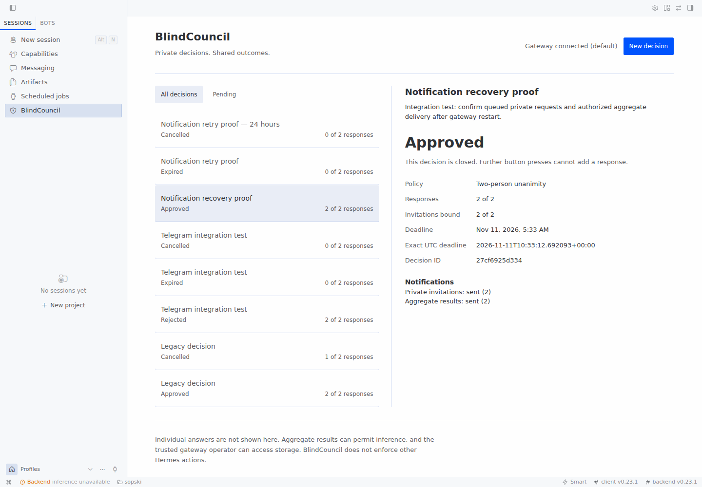

# BlindCouncil

**Private decisions. Shared outcomes.**

Human decisions shouldn't be guessed by an AI or lost in a group chat. **BlindCouncil is a native Hermes Agent plugin for collecting authenticated human responses, applying deterministic decision rules, and keeping a durable record of the shared result.**

Telegram is the first participation channel. **Version 0.1.0 implements a two-account, collect-both unanimous decision workflow**—a working first step toward broader human-decision infrastructure for AI-assisted work.

[How it works](#how-it-works) · [Try it](#install-and-try-it) · [Verified demo evidence](#verified-in-practice) · [Security boundaries](#privacy-and-trust) · [Architecture](docs/ARCHITECTURE.md)



*Real Hermes decision history and aggregate notifications, not a mockup. [Dark interface](docs/media/native-decision-dark.png).*

## The problem

A release checklist, purchasing request, or operational decision can require several people's judgment. In group chats, responses become scattered; in private messages, coordinators must identify who replied, match each answer to the right request, enforce deadlines, and recover when delivery fails.

A language model can summarize that conversation, but a prompt alone does not authenticate a Telegram account, reject a repeated button press, or persist an immutable response through a gateway restart.

BlindCouncil handles those responsibilities at the plugin and storage boundary, while humans remain responsible for their own decisions.

## Who it's for

- **Team leads and managers** coordinating release reviews and operational sign-offs.
- **Organizations and committees** that need a visible decision process rather than scattered informal replies.
- **Hermes developers** exploring dependable human participation in AI-assisted workflows.

**Important scope:** this release coordinates and records decisions. It does **not** yet automatically block arbitrary Hermes tools, grant permission to execute an action, or implement a general multi-person policy engine.

## How it works

1. An authorized coordinator creates a named decision in the native Hermes Desktop interface or CLI.
2. Two configured, allowlisted Telegram accounts receive **separate private requests** with Approve and Reject buttons.
3. Each response is checked against the Telegram account, bound private message, decision membership, and current state. A response is recorded only once.
4. The current **collect-both unanimous policy** resolves after both responses: two approvals mean **APPROVED**; any rejection means **REJECTED**. One response alone leaves the decision **PENDING**.
5. Hermes Desktop displays progress, decision history, expiry and aggregate results. The notification worker persists outgoing work and can retry eligible failed deliveries.

Cancelled and expired rounds cannot accept new votes. Decision history and queued notifications survive normal gateway restarts.

## Verified in practice

BlindCouncil has been exercised with **two distinct Telegram accounts owned by one tester**, with genuine button presses and native Hermes gateway behavior. That demonstrates separate authenticated account identities, **not** two independent humans.

| Scenario | Evidence |
| --- | --- |
| Two private approvals and deterministic result | [Native approval](docs/evidence/native-two-account-approval.json) |
| Rejection and repeated-response protection | [Rejection](docs/evidence/native-rejection.json) · [Duplicate denial](docs/evidence/native-duplicate.json) |
| Invalid message, revocation, cancellation and expiry | [Security denials](docs/evidence/native-security-denial.json) · [Expiry](docs/evidence/native-expiry.json) |
| Persistence through restart | [Restart comparison](docs/evidence/native-restart.json) |
| Blocked Telegram delivery and targeted recovery | [Retry audit](docs/evidence/native-delivery-recovery.json) · [Human confirmation](docs/evidence/human-recovery-confirmation.json) |
| Native Hermes interface displaying real history | [Browser proof](docs/evidence/native-ui-20261110/primary-history-proof.json) |

The repository also includes **64 passing supporting tests** with actual Hermes SQLite and synthetic transport/identities, plus official Hermes installation, Doctor and validation evidence. These tests are not represented as additional live human sessions.

**For judges:** Begin with the image above and the [two-account approval record](docs/evidence/native-two-account-approval.json). For a hands-on local run, follow the steps below. There is no publicly hosted, account-free Hermes instance.

## Install and try it

Requires **Hermes Agent 0.23.1 or newer** with Telegram gateway support. Install the reviewed plugin source at its catalog-pinned commit:

```bash
hermes plugins install https://github.com/sopskistar/blindcouncil.git \
  --ref 2a7ceb4b75bfc24d9fa45349b08764eaeb082e48 \
  --enable --yes-deps
```

The install prepares the declared `python-telegram-bot==22.8` dependency. Review dependencies before approving installation.

Configure the integration in your own Hermes profile:

1. Run `hermes gateway setup` and configure **one Telegram bot** with both intended participant accounts on its allowlist. Keep its token in Hermes' secret configuration.
2. Each account must open the bot and press **Start** before the bot can send it private invitations.
3. Run `hermes blindcouncil configure` and provide the two distinct Telegram numeric account IDs locally. Account 1 is the coordinator in this version.
4. Run `hermes blindcouncil readiness`, then use your normal Hermes gateway process. **Do not start a second poller for the same bot.**

Create and inspect a real decision:

```bash
hermes blindcouncil create --title "Release checklist" --expires 24h
hermes blindcouncil status --round-id ROUND_ID
hermes blindcouncil history --limit 20
```

Both accounts receive individual requests. Press Approve on the first and inspect the still-pending decision; approve on the second to see the unanimous result. Pressing an already answered button again does not add another response.

Other supported operator commands:

```bash
hermes blindcouncil cancel --round-id ROUND_ID
hermes blindcouncil notifications --round-id ROUND_ID
hermes blindcouncil retry-notifications --round-id ROUND_ID
```

The native Desktop/Webapp page can create, view, cancel and inspect decisions, and review notification state. Enable it through **Capabilities → Plugins** after installing. See the [Desktop guide](docs/DESKTOP.md) for local authentication and Windows/WSL access.

## Built natively for Hermes

BlindCouncil uses Hermes' official Telegram platform handler, lifecycle-managed background task, plugin SQLite storage, local CLI commands, authenticated operator RPC and Desktop SDK. It does **not** run an independent Telegram poller or require a hosted database, a paid AI model, or modifications to Hermes' core.

[Architecture](docs/ARCHITECTURE.md) · [Notification recovery](docs/NOTIFICATIONS.md) · [Desktop integration](docs/DESKTOP.md) · [Troubleshooting](docs/TROUBLESHOOTING.md)

## Privacy and trust

Individual Telegram responses are not displayed in the participant-facing aggregate or operator progress view. **Aggregate outcomes may still reveal another person's vote by inference**, especially with only two people. The trusted Hermes host/operator and installed in-process code can access the local database.

This is not end-to-end encryption, zero knowledge, tamper-proof storage, a proof of independent human identity, or a guarantee of exactly-once external Telegram delivery. The plugin does not currently enforce approvals before other Hermes actions.

See [SECURITY.md](SECURITY.md) for data handling, trust boundaries and retention.

## Beyond the first release

The broader direction is a reusable human-decision and authorization engine, with additional decision policies, participants, response channels and carefully scoped action-bound approvals. These are **future work**, not features claimed in this build. See the [roadmap](ROADMAP.md) and [capability audit](docs/CAPABILITY_AUDIT.md).

MIT licensed · [Source](blindcouncil/) · [Tests](tests/) · [Hermes catalog pull request #152770](https://github.com/NousResearch/hermes-agent/pull/152770)
