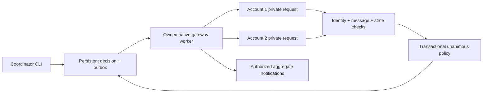

# BlindCouncil

**Two people decide privately. Hermes delivers the shared outcome.**

A release coordinator needs two reviewers to agree before calling a checklist approved. A group chat makes every answer public; private messages leave the coordinator checking identities, counting replies, chasing failed deliveries and reconstructing what survived a restart.

BlindCouncil puts that workflow inside Hermes. It sends separate Telegram requests, accepts one authenticated response per account and applies a persisted unanimous policy. The coordinator sees progress and the aggregate result; no model decides how a person voted.

BlindCouncil’s product vision is a privacy-conscious human authorization and decision engine for Hermes. **Telegram is its first response channel.** The current build implements authenticated decision coordination and deterministic outcomes; it has **no agent-facing tools or protected action executor yet**. Action-bound approval for one exact structured operation is being investigated separately. See the [capability audit](docs/CAPABILITY_AUDIT.md) for implemented, tested and future boundaries.

**[Judge walkthrough](#judges-start-here) · [Genuine Telegram evidence](#what-is-verified) · [Source](blindcouncil) · [Architecture](docs/ARCHITECTURE.md) · [Security](SECURITY.md)**

**Status:** working native Hermes/Telegram core and a real Desktop/Webapp create/cancel/history flow. The interface is currently browser-tested in a token-free profile with synthetic participants; deployment against genuine Telegram history and remaining UI checks are still open. Public GitHub/catalog and demo video are pending. No hosted public demo or fabricated application screenshot is claimed.

## Judges: start here

**Shortest path without accounts:** open the [two-account native approval audit](docs/evidence/native-two-account-approval.json), then the [real wrong-message/revocation denials](docs/evidence/native-security-denial.json) and [human-confirmed delivery recovery](docs/evidence/human-recovery-confirmation.json). These are sanitized records from actual gateway sessions and user button presses, not fixture responses. [Provenance hashes](docs/evidence/PROVENANCE.json) preserve the exported originals; the records are local observations, not cryptographic attestations.

**Run the actual workflow:** [install and configure](#install-and-configure) one bot with two allowlisted accounts, keep one native gateway running, then:

```bash
hermes blindcouncil create --title "Release checklist" --expires 24h
hermes blindcouncil status --round-id ROUND_ID
```

1. On Account 1's private request, press **Approve**. Status remains **PENDING**, with one response.
2. On Account 2's own request, press **Approve**. The result becomes **APPROVED** and both authorized participants receive the aggregate.
3. Press an already answered button again. It reports **Your response is already recorded** and adds no vote.
4. To see rejection, create a fresh round and choose **Approve** on one account and **Reject** on the other. The result is **REJECTED**. Do not reuse or edit old responses.

The first response stays pending even if it is a rejection: this version collects both responses before resolving. The live outcomes above were already exercised; no judge needs to trust an AI-generated transcript. [Approval](docs/evidence/native-two-account-approval.json), [rejection](docs/evidence/native-rejection.json), [duplicate protection](docs/evidence/native-duplicate.json).

## What is verified

| Behavior | Evidence | Test boundary |
|---|---|---|
| Two distinct configured accounts approve | [Native audit](docs/evidence/native-two-account-approval.json) | Genuine Telegram callbacks and human confirmation |
| Mixed responses reject; a repeated tap adds nothing | [Rejection](docs/evidence/native-rejection.json), [duplicate](docs/evidence/native-duplicate.json) | Genuine Telegram callbacks |
| Wrong message and revoked participant denied, with zero votes | [Security audit](docs/evidence/native-security-denial.json) | Genuine callbacks; decision-scoped authorization |
| Cancellation/expiry reject late responses | [Cancellation](docs/evidence/native-cancellation.json), [expiry](docs/evidence/native-expiry.json) | Genuine late button presses |
| Stored rounds survive a gateway restart | [Before/after comparison](docs/evidence/native-restart.json) | Actual native gateway stop/start |
| Aggregate reaches both participants | [Delivery audit](docs/evidence/native-approved-notifications.json) | Real Telegram deliveries, confirmed on both accounts |
| Blocked recipient recovers without resending the successful invitation | [Forbidden](docs/evidence/native-blocked-delivery.json), [targeted retry](docs/evidence/native-delivery-recovery.json), [user confirmation](docs/evidence/human-recovery-confirmation.json) | Real block/unblock; original error and exact deadline retained |
| Policy, rollback, migration, concurrency, delivery and operator RPC boundary | [63 passing methods](docs/evidence/operator-rpc-tests-20261110-r1/result.json), [transcript](docs/evidence/operator-rpc-tests-20261110-r1/stderr.log) | Actual Hermes SQLite; synthetic identities/transport/context; no Telegram network |
| Native Webapp creation, practical expiry, cancellation and history | [Browser and stored-state proof](docs/evidence/native-ui-20261110/browser-and-storage-proof.json) | Real Hermes browser/RPC/SQLite; synthetic participants; no Telegram delivery claimed |

These are scoped integration proofs, not production load or adversarial security certification. A globally unallowlisted third account was not tested live. The owner used two accounts; distinct account identities do not establish independent humans. [Real installation/removal/reinstallation](docs/evidence/installer-lifecycle-20261110/lifecycle-summary.json) retained all fixture records. Final compatibility/validation results are tracked in [PROJECT_STATUS.md](PROJECT_STATUS.md).

## Why this belongs in Hermes

Hermes owns the gateway, bot credentials, configuration, plugin loading and persistent storage. BlindCouncil contributes the policy and coordination state through official interfaces:

| Hermes surface | BlindCouncil's job | Implementation |
|---|---|---|
| `ctx.register_platform_handler("telegram", factory)` | Receive native account/message identities and add only `blindcouncil:` callbacks | [Native registration](blindcouncil/__init__.py) |
| `ctx.spawn_task` | Run owned notification work using Hermes' existing bot | [Worker](blindcouncil/notification_worker.py) |
| `plugins.plugin_storage.plugin_db()` | Persist decisions, responses, bindings and retry history | [Policy](blindcouncil/policy.py), [schema](blindcouncil/lifecycle.py) |
| `ctx.register_cli_command` | Create, inspect, cancel and retry without a model call | [Operator CLI](blindcouncil/__init__.py) |

See Hermes' [plugin guide](https://hermes-agent.nousresearch.com/docs/developer-guide/plugins) and [public API](https://hermes-agent.nousresearch.com/docs/developer-guide/plugins/public-api). No independent poller, core patch, private renderer modification or MCP server is needed.

The software replaces manual response bookkeeping: send both requests, associate each answer with the original private message, keep an immutable response, enforce a deadline, calculate the aggregate, recover queued work and show delivery failures. A prompt can describe those rules; the stored transactions and transport checks actually enforce them at this plugin's boundary. There is no model-facing vote-submission tool. Trusted host operators remain outside that boundary.

## Architecture



The durable queue retains retries and permanent failures. A message binding is committed before actionable buttons are attached. A terminal decision cannot become pending again. Details and limitations are in [architecture](docs/ARCHITECTURE.md) and [notification recovery](docs/NOTIFICATIONS.md).

## Install and configure

Use a recent official Hermes installation with Telegram support. Install this repository at an explicitly reviewed 40-character commit:

```bash
hermes plugins install <GIT_URL> --ref <REVIEWED_40_CHARACTER_SHA> --enable --yes-deps
```

These placeholders are intentional until publication. `--yes-deps` consents to Hermes preparing the declared Python dependency; review it first. Interactive installation can ask instead. Hermes owns dependency management.

1. Run `hermes gateway setup` in your own terminal. Configure **one Telegram bot** and explicitly allowlist both participant IDs. Keep its token in Hermes' local secret configuration.
2. Both accounts must open that same bot and press **Start**. A bot cannot initiate a private conversation with an account that has not started it.
3. Run `hermes blindcouncil configure`. Enter the two distinct numeric account IDs locally. Account 1 is the coordinator and also a participant. No bot token is requested by this command.
4. Run `hermes blindcouncil readiness`, then start your usual `hermes gateway run`. Run only one gateway poller for the bot.

The commands use your selected Hermes home/profile. For an experiment, set `HERMES_HOME` to a dedicated home before installation and setup. Do not copy an unrelated profile's secrets or change its settings.

## Make a decision

```bash
hermes blindcouncil create \
  --title "Approve the release checklist" \
  --description "Both reviewers must confirm that the checklist is complete." \
  --expires 24h
hermes blindcouncil status --round-id ROUND_ID
hermes blindcouncil history --limit 20
```

Each participant receives a separate private request with **Approve** and **Reject** buttons. One accepted response leaves the round PENDING. After both respond, two approvals produce APPROVED; a rejection produces REJECTED. Responses are immutable. This release collects both responses before resolving, including when the first response is a rejection.

Normal expiry choices are `15m`, `1h`, `24h`, `3d` and `7d`; the default is **24 hours**. The exact UTC deadline is persisted once and is never extended by a restart or retry. Short `/bcprobe expire SECONDS` durations exist solely for explicit integration tests.

```bash
hermes blindcouncil cancel --round-id ROUND_ID
hermes blindcouncil notifications --round-id ROUND_ID
hermes blindcouncil retry-notifications --round-id ROUND_ID
```

Inspect notification status before retrying. Retry queues only blocked work for that round. After expiry or cancellation an old invitation cannot be revived; a blocked terminal result is a different kind of message. Transient failures retry automatically with bounded backoff. Unblock the bot and press Start before retrying a Forbidden delivery. See [notification recovery](docs/NOTIFICATIONS.md).

## Privacy and authority

- Participants receive private requests and authorized aggregate outcomes. Operator CLI outputs expose progress and aggregates, not individual answers or account IDs.
- Two-person unanimity can permit someone to **infer** another person's answer from their own answer and the aggregate. This is controlled disclosure, not cryptographic secrecy.
- The trusted gateway operator, host and installed in-process code can access the local database. This is not end-to-end encryption, zero knowledge or tamper-proof storage.
- Two Telegram accounts prove distinct authenticated account identities, not two independent humans.
- BlindCouncil does **not** currently authorize or block other Hermes actions. Action-bound enforcement is planned. No Hermes-wide enforcement is claimed.
- Telegram may deliver duplicates after an uncertain network acknowledgement. Database mutations and logical notification work are idempotent; exactly-once external delivery is not promised.

Read [security and data handling](SECURITY.md) before using sensitive decisions.

## Compatibility and development

Version **0.1.0**, schema **3**. Tested with official Hermes source `2c955c3a8c0bf8f52cbfad13ed3215ade4eb6f94` (`vgit.2c955c3`), Python 3.14.9 and python-telegram-bot 22.8. The native factory runs **in process** and requires the official native-handler and supervised-task APIs. Hermes **0.23.1 or newer** is the conservative declared floor; 55 supporting methods and real installation/enablement also passed on the official v0.23.1 tag. The original live Telegram proof used the earlier pinned source above; the running gateway was not upgraded for this release check. [Tested source hashes and environment](docs/evidence/packaged-tests-20261110-r1/result.json).

```bash
hermes plugins doctor . --ci
hermes plugins validate . --install-deps
python3 scripts/test.py --help
```

The [supporting runner](scripts/test.py) reuses an existing Hermes-managed environment and creates temporary credential-free homes. It never starts Telegram polling or loads the live secret configuration. [Troubleshooting](docs/TROUBLESHOOTING.md) covers failed delivery, authorization and recovery.

```text
__init__.py          native Hermes loader entry
plugin.yaml          metadata, settings and pinned Python dependency
blindcouncil/        native handlers, policy, lifecycle, outbox and worker
tests/               supporting policy, security and recovery regressions
scripts/test.py      isolated test runner
docs/evidence/       sanitized original live proofs and supporting results
SECURITY.md          trust, disclosure, retention and deletion
PROJECT_MASTER_PLAN.md / ROADMAP.md / HANDOFF.md   durable scope and continuation
```

Desktop/Webapp UX is **partly implemented and browser-tested** as described above. Agent-callable authorization requests, a fail-closed action executor, additional policies and additional platforms remain **planned**. Only two-person collect-both unanimity exists today. A prospective first protected action is an exact bounded release note in plugin-owned storage; no grant or execution test exists yet. Current aggregate messages do not authorize other Hermes actions. The full [master plan](PROJECT_MASTER_PLAN.md) and [roadmap](ROADMAP.md) preserve that scope without claiming it shipped.

MIT licensed: [LICENSE](LICENSE). No paid model API or hosted database is required by the implemented workflow. The plugin does not depend on a Vercel site.
